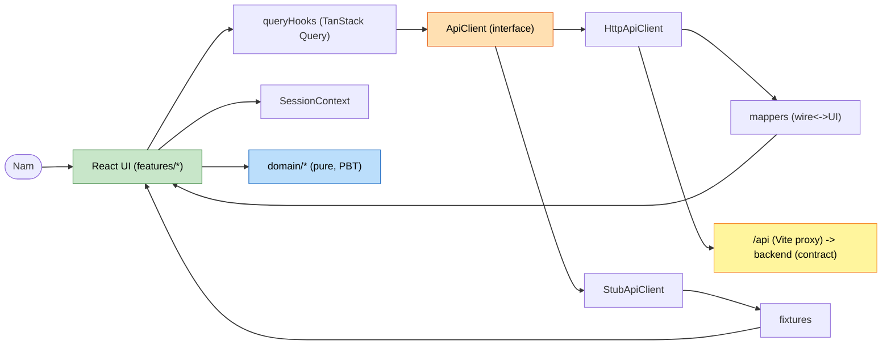

# Component Dependencies & Data Flow — Career-Path Planner (Frontend)

## Dependency Matrix (depends-on →)
| Component | Depends on |
|---|---|
| AppRouter | RequireProfile, LoginPage, ProfilePage, LandingPage, AppProviders |
| AppProviders | TanStack QueryClient, SessionContext |
| RequireProfile | SessionContext |
| LoginPage / UsernameForm | queryHooks(useCreateOrLoadProfile), SessionContext, shared UI |
| ProfilePage | queryHooks(useProfile/useUpdateProfile/usePlans), SessionContext, shared UI |
| LandingPage | CourseSelector, SkillSelector, CareerSelector, RadarChart, RadarDataTable, StudyPathway, PathwayConflicts |
| CourseSelector/SkillSelector/CareerSelector | Combobox, queryHooks(useSearch*) |
| RadarChart | react-chartjs-2 (Chart.js), domain/radar, types |
| RadarDataTable | types (accessible equivalent of RadarChart) |
| StudyPathway / PathwayStepCard | types |
| PathwayConflicts | types |
| queryHooks | ApiClient |
| ApiClient (Http) | mappers, wire types, fetch(/api) |
| ApiClient (Stub) | fixtures, UI types |
| domain/* | types only (no React, no network) |
| mappers | wire types + UI types |

## Communication Patterns
- UI → **query hooks** → **ApiClient** → (`HttpApiClient` maps wire→UI | `StubApiClient` fixtures) → UI.
- UI → **SessionContext** for active profile; **RequireProfile** guards routes.
- Pure **domain/** functions are called by Landing components (and mirrored by backend rules).
- Single wire↔UI boundary in **mappers** (prevents naming drift with backend).

## Data Flow (Mermaid)

## Build order (matches units)
1. **Unit 1**: types, wire, mappers, ApiClient (+Stub), queryHooks, SessionContext, AppRouter, RequireProfile, LoginPage.
2. **Unit 2**: ProfilePage + ProfileEditor + SavedPlansList (reuses Combobox, queryHooks).
3. **Unit 3**: selectors, domain/*, RadarChart + RadarDataTable, StudyPathway + PathwayConflicts.
