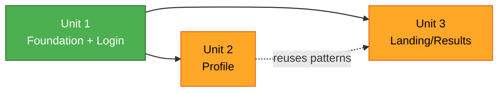

# Unit of Work Dependencies — Career-Path Planner (Frontend)

## Dependency Matrix
| Unit | Depends on | Reason |
|---|---|---|
| Unit 1 — Foundation + Login | (none) | Establishes shared lib/, app shell, ApiClient+Stub, session |
| Unit 2 — Profile | Unit 1 | Uses ApiClient, queryHooks, SessionContext, RequireProfile, shared UI |
| Unit 3 — Landing/Results | Unit 1 (and reuses patterns from Unit 2) | Uses ApiClient, queryHooks, session, Combobox; adds domain/ + Chart.js |

## Build Order (strict, per-unit loop)
1. Unit 1 → 2. Unit 2 → 3. Unit 3

- Acyclic: later units depend only on earlier ones.
- Unit 1 is the critical path (all units rely on the foundation).
- `domain/` is built in Unit 3 (first needed there); `mappers` are built in Unit 1 and PBT-tested there.

## Shared Resources
- `lib/` (types, wire, mappers, ApiClient, queryHooks, SessionContext) — created in Unit 1, consumed by all.
- `components/` — seeded in Unit 1, extended by Units 2 and 3 as needed.

## Dependency Diagram (Mermaid)

