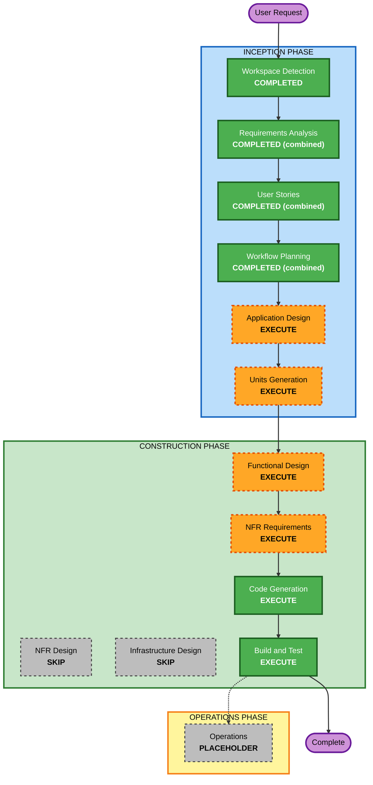

# Execution Plan — Course & Career Navigator (Combined)

> Combined inception: reconciles this repo's frontend plan with the dataset+concept plan. Frontend design authoritative; the combined project builds the full stack (backend implemented + seeded from the dataset). See `../combined-inception.md`.

## Analysis Summary
- **Project Type**: Full-stack build on this repo's scaffold (`backend/`, `frontend/`, `docker-compose.yml`).
- **User-facing**: Yes — 3-page React/TS app as designed in this repo.
- **Data model**: Yes — PostgreSQL schema implementing the contract, seeded from the dataset.
- **API**: Implement `backend/API-CONTRACT.md` in FastAPI.
- **Risk**: Low–Medium (local PoC via Docker Compose; stub keeps frontend runnable independently).

## Workflow Visualization

### Text Alternative
INCEPTION: Workspace Detection (DONE) → Requirements (DONE, combined) → User Stories (DONE, combined) → Workflow Planning (DONE, combined) → Application Design (EXECUTE) → Units Generation (EXECUTE). CONSTRUCTION: Functional Design (EXECUTE) → NFR Requirements (EXECUTE) → NFR Design (SKIP) → Infrastructure Design (SKIP) → Code Generation (EXECUTE) → Build and Test (EXECUTE). OPERATIONS: placeholder.

## Phases
- Application Design — **EXECUTE**: define frontend module/page structure (matching this repo's frontend), backend service structure, shared types, and how the backend implements the contract + seeds the dataset.
- Units Generation — **EXECUTE** (see units below).
- Functional Design — **EXECUTE**: competency normalization formula, skill-gap, pathway scheduler, seeding transforms; PBT property identification.
- NFR Requirements — **EXECUTE** (minimal): confirm stack; pick radar chart lib + headless component lib + router (frontend); confirm Hypothesis (backend) + fast-check (frontend) for PBT.
- NFR Design — **SKIP**: satisfied by library/pattern choices.
- Infrastructure Design — **SKIP**: Docker Compose already provided.
- Code Generation — **EXECUTE** (per unit).
- Build and Test — **EXECUTE**: `docker compose up --build`; backend pytest+Hypothesis; frontend Vitest+fast-check; end-to-end against the seeded backend and against the stub.

## Units of Work (combined)
Aligned to the frontend phasing, plus a backend unit so the full stack works:
1. **U1 — Frontend Foundation & Login**: app shell, routing, shared domain types, typed API client + stub, login/create-profile. (US-0.x, US-1.x)
2. **U2 — Frontend Profile**: view/edit profile, saved plans. (US-2.x)
3. **U3 — Frontend Landing/Results**: typeaheads, career selection, competency, radar w/ toggle + text alt, stepwise pathway, responsive/accessible. (US-3.x)
4. **U4 — Backend (Contract Implementation + Dataset Seeding)**: FastAPI + SQLModel models for Skill/Course/Career/Profile/Plan; endpoints per `backend/API-CONTRACT.md`; competency/radar/pathway services; startup seeding from `backend/seed_data/`. (US-4.x)

**Dependencies**: U1 → U2, U3 (shared types/client). U3 and U4 share the contract; U4 can be built in parallel with U1–U3 against the contract, and integrated once ready (frontend uses the stub meanwhile).

## Success Criteria
Combined SC-1 … SC-7 (see `../combined-inception.md` §10).

## Extension Configuration
Security: No · Resiliency: No · PBT: Partial (PBT-02, 03, 07, 08, 09) — Hypothesis (backend) + fast-check (frontend).
