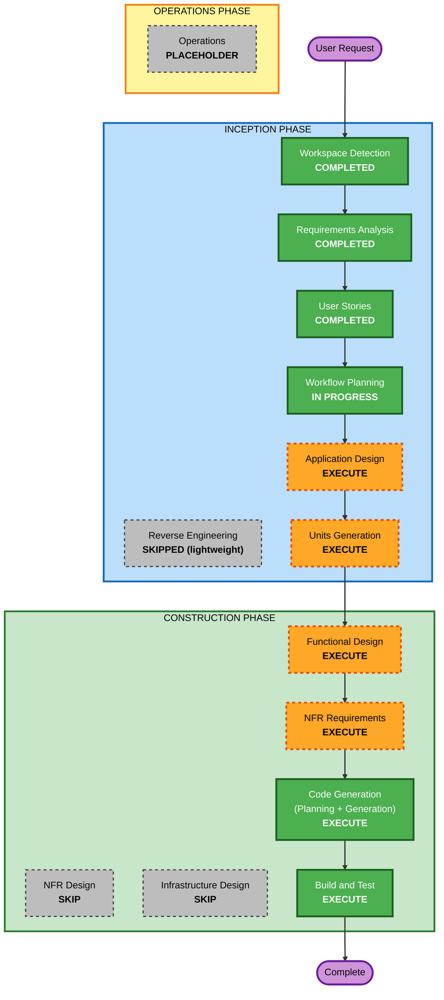

# Execution Plan — Career-Path Planner (Frontend)

## Detailed Analysis Summary

### Transformation Scope (Brownfield)
- **Transformation Type**: Additive feature build within an existing monorepo starter (frontend-focused).
- **Primary Changes**: Replace the frontend starter shell with a multi-page app (Login, Profile, Landing) including routing, typed API client + stub layer, catalog selection, radar chart, and study-pathway visualization.
- **Related Components**: Frontend only. Backend is contract-only (see `backend/API-CONTRACT.md`); no backend code changes in this engagement.

### Change Impact Assessment
- **User-facing changes**: Yes — entire deliverable is new user-facing UI across three pages.
- **Structural changes**: Yes (frontend) — introduce routing, feature/module structure, API client + stub, shared domain types; no backend architecture change.
- **Data model changes**: No persisted schema here. Frontend-side TypeScript domain types mirror the API contract.
- **API changes**: Contract defined (draft) for the frontend to consume; implementation out of scope.
- **NFR impact**: Yes — responsiveness, WCAG 2.1 AA accessibility, testability (PBT Partial).

### Component Relationships
- **Primary Component**: `frontend/` (Vite + React + TS + Tailwind v4).
- **Shared Components**: Frontend domain types + typed API client (mirrors `backend/API-CONTRACT.md`).
- **Dependent Components**: Backend (future) consumes the same contract — currently decoupled via stub.
- **Supporting Components**: Vitest + Testing Library (+ fast-check to be added).

### Risk Assessment
- **Risk Level**: Low-to-Medium. Isolated to the frontend; stub layer removes backend dependency. Medium elements are the radar visualization and pathway presentation.
- **Rollback Complexity**: Easy (frontend-only, version controlled).
- **Testing Complexity**: Moderate (component tests + PBT for pure logic).

## Workflow Visualization

## Phases to Execute

### INCEPTION PHASE
- [x] Workspace Detection (COMPLETED)
- [x] Reverse Engineering (SKIPPED — tiny starter; relevant facts captured inline)
- [x] Requirements Analysis (COMPLETED)
- [x] User Stories (COMPLETED)
- [x] Execution Plan (IN PROGRESS)
- [ ] Application Design — **EXECUTE**
  - **Rationale**: New frontend architecture needed — page/route structure, feature modules, shared domain types, typed API client + swappable stub, component boundaries (typeahead, radar, pathway). Defines how pieces fit before coding.
- [ ] Units Generation — **EXECUTE**
  - **Rationale**: Decompose into units aligned to your phasing (Unit 1 = Foundation+Login, Unit 2 = Profile, Unit 3 = Landing/Results), so each is designed and built to completion in order.

### CONSTRUCTION PHASE (per unit)
- [ ] Functional Design — **EXECUTE**
  - **Rationale**: Non-trivial pure logic (skill-competency derivation, skill-gap, pathway ordering/scheduling on the frontend side, contract (de)serialization). Also required for PBT-01 property identification.
- [ ] NFR Requirements — **EXECUTE**
  - **Rationale**: Confirm accessibility (WCAG 2.1 AA), performance (debounced typeahead), and select the frontend tech additions — router, headless component library, radar chart library (Q9), and PBT framework fast-check (PBT-09).
- [ ] NFR Design — **SKIP**
  - **Rationale**: NFR concerns here are satisfied by library/pattern choices captured in NFR Requirements + Application Design; no separate NFR architecture layer (no infra, no backend) warrants a distinct stage.
- [ ] Infrastructure Design — **SKIP**
  - **Rationale**: No infrastructure changes. Dev already runs via existing Docker Compose + Vite; no cloud resources in scope.
- [ ] Code Generation — **EXECUTE (ALWAYS)**
  - **Rationale**: Build the frontend per unit with tests (example-based + PBT for pure logic).
- [ ] Build and Test — **EXECUTE (ALWAYS)**
  - **Rationale**: Run frontend build + Vitest + fast-check with seed logging; verify end-to-end against the stub.

### OPERATIONS PHASE
- [ ] Operations — PLACEHOLDER

## Units of Work (proposed, matches user's phasing)
1. **Unit 1 — Foundation & Login** (easiest): app shell + routing, shared domain types, typed API client + stub, login/create-profile. (US-0.1, US-0.2, US-0.3, US-1.1, US-1.2)
2. **Unit 2 — Profile**: view/edit profile, saved plans. (US-2.1, US-2.2, US-2.3)
3. **Unit 3 — Landing/Results** (most complex): catalog typeaheads, career selection, competency derivation, radar chart w/ toggle, stepwise pathway, responsive/accessible results. (US-3.1–US-3.7)

## Estimated Timeline
- **Total remaining stages**: Application Design, Units Generation, then per-unit (Functional Design, NFR Requirements, Code Generation) x3 units, then Build and Test.
- **Estimated effort**: Moderate — most complexity concentrated in Unit 3.

## Success Criteria
- **Primary Goal**: A responsive, accessible, multi-page frontend that fulfills SC-1..SC-7, runnable end-to-end against the typed stub mirroring `backend/API-CONTRACT.md`.
- **Key Deliverables**: Routing + 3 pages; typed API client + stub; radar chart w/ career toggle + text alternative; stepwise pathway with conflict surfacing; profile + saved plans; component tests + PBT for pure logic.
- **Quality Gates**: Frontend build passes; Vitest + fast-check green (seed logged); WCAG 2.1 AA practices applied (with the caveat that full conformance needs manual AT testing).
